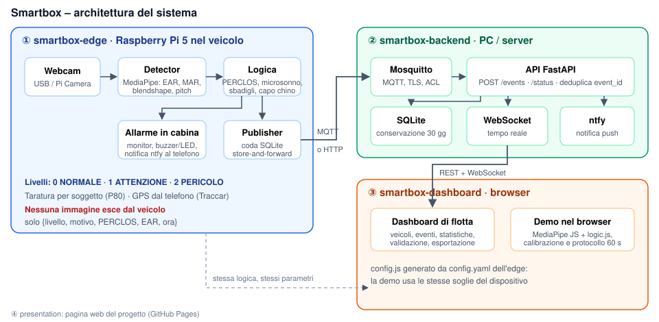

# Smartbox – presentazione del progetto

Monitoraggio della sonnolenza del guidatore – corso di perfezionamento 2025/26, UniSalento IDA Lab.

## Il progetto

**Smartbox** è un sistema per il monitoraggio della sonnolenza del guidatore. Una webcam nell'abitacolo,
collegata a un Raspberry Pi 5, osserva il volto del guidatore; il software di bordo misura chiusura degli
occhi (PERCLOS e microsonni), sbadigli e chinamento del capo e classifica lo stato su tre livelli:
**0 NORMALE**, **1 ATTENZIONE**, **2 PERICOLO**. L'allarme scatta in cabina (monitor, buzzer/LED,
notifica sul telefono) anche senza rete. Al server di flotta arriva solo una sintesi di ogni evento:
**nessuna immagine esce dal veicolo**.

Il progetto nasce da un prototipo di tesi (notebook Colab, versione 3) ed è stato portato a un sistema
completo *dispositivo di bordo → backend → dashboard web* (versione 4.1), verificato con prove registrate
e con l'installazione su Raspberry Pi 5.

Pagina di presentazione: **https://unisalento-idalab-corsoperfez-25-26.github.io/perfez-2526-presentation-Congedo/**

## Architettura del sistema

1. **Dispositivo di bordo (edge)**: acquisizione, misure dal volto con MediaPipe Face Landmarker,
   logica di allarme, allarme in cabina e invio degli eventi con coda *store-and-forward*.
2. **Backend**: riceve eventi e stati via MQTT (Mosquitto, TLS, ACL) o HTTP, li deduplica, li archivia in
   SQLite, li spinge alla dashboard via WebSocket e invia notifiche ntfy.
3. **Dashboard**: dashboard di flotta e demo nel browser, che esegue la stessa logica del dispositivo.
4. **Presentazione**: pagina web del progetto.

Formato degli eventi (`smartbox-evento/2`): `event_id`, veicolo, ora ISO 8601 con fuso, livello e livello
precedente, motivo, PERCLOS, EAR. Gli stati periodici (`smartbox-stato/1`) riportano fps, temperatura e
modalità del dispositivo.

## Repository dei componenti

| Componente | Repository |
|---|---|
| Dispositivo di bordo (Raspberry Pi 5) | [perfez-2526-smartbox-edge-Congedo](https://github.com/UniSalento-IDALab-corsoPerfez-25-26/perfez-2526-smartbox-edge-Congedo) |
| Backend (API, MQTT, archivio, notifiche) | [perfez-2526-smartbox-backend-Congedo](https://github.com/UniSalento-IDALab-corsoPerfez-25-26/perfez-2526-smartbox-backend-Congedo) |
| Dashboard di flotta e demo nel browser | [perfez-2526-smartbox-dashboard-Congedo](https://github.com/UniSalento-IDALab-corsoPerfez-25-26/perfez-2526-smartbox-dashboard-Congedo) |
| Pagina di presentazione (GitHub Pages) | [perfez-2526-presentation-Congedo](https://github.com/UniSalento-IDALab-corsoPerfez-25-26/perfez-2526-presentation-Congedo) |

## Questo repository: pagina di presentazione

Pagina web del progetto pubblicata con GitHub Pages: **https://unisalento-idalab-corsoperfez-25-26.github.io/perfez-2526-presentation-Congedo/**

| File | Contenuto |
|---|---|
| `index.html` | La pagina (HTML e CSS in un solo file, senza librerie esterne) |
| `docs/architettura.svg` | Schema dell'architettura, lo stesso dei README |

Pubblicazione: *Settings → Pages → Deploy from a branch → `main` / root*.

## Licenza

GPL-3.0, vedi [LICENSE](LICENSE).
